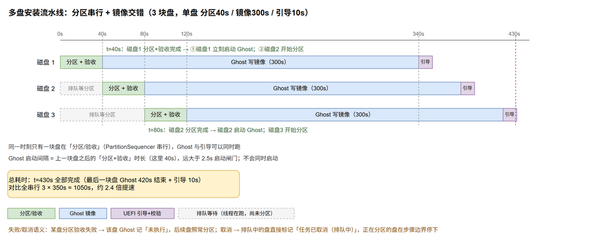
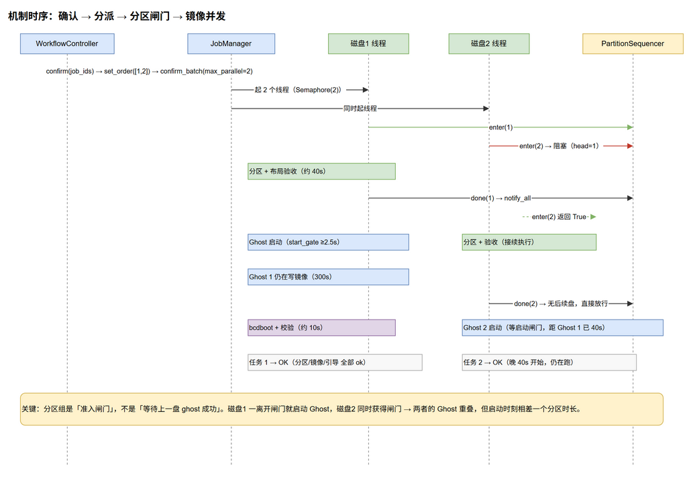
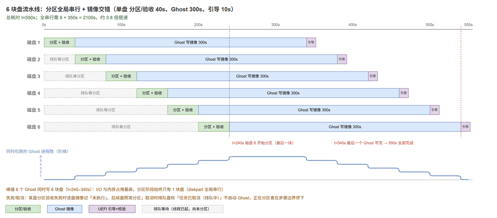

# 多盘并发改造实施文档

> 历史文档：文中 `dry-run` / 演练模式已于 1.2.0 移除（`prepare` 与脚本预览仍然只读）；其余并发设计仍然有效，保留原文作为改造过程记录。（已归档）

> **状态：🗄 已归档（2026-11-08）** —— 多盘并发改造（A / B / C / D）已全部完成、
> 通过 VM 验证并合并进 `main`（提交 `079a25a`，后续 `2559e97` 的 `copy` 收尾步骤在其之上）。
> **本文件不再更新**，仅作设计与验收的历史记录；当前行为以
> [架构与工作流](架构与工作流.md) 的「多盘并发」小节与 [安全边界](安全边界.md) 的多盘边界为准，
> 代码与本文若有出入，一律以代码为准。
> 适用范围：`app/application/` 执行链路、`app/gui_web/ui/js/view-install.js` 进度展示
> 相关文档：[架构与工作流](架构与工作流.md) · [安全边界](安全边界.md) · [测试指南](测试指南.md)

## 0. 实施结果摘要

| 阶段 | 内容 | 状态 |
| --- | --- | --- |
| A | `app/application/coordination.py`（`PartitionSequencer` / `GhostStartGate`）、`shell.py` 的 `_DISKPART_LOCK`、`command_log.py` 文件名唯一化、`phases/ghost.py` 的启动闸门与 8027 重试 | ✅ |
| B | `JobPipeline(sequencer=)`、`real_runner` 注入与独立工作目录、`WorkflowController` 并发默认值（`worker_interval=0`、`max_parallel=0`）、`confirm()` 设定顺序 | ✅ |
| C | 进度页「排队等待分区」文案、四份文档同步 | ✅ |
| D | VM 端到端（2 块 90 GB VHD + 真实 ghost64 / bcdboot）+ 编包冒烟 | ✅ |

测试：新增 `tests/test_coordination.py`（10 条）与 `tests/test_concurrency.py`（7 条），
`tests/test_ghost_image.py` 增加 4 条重试/闸门用例；归档时的全量基线为 **520 passed**
（交付当时是 488，之后随 `copy` 收尾步骤与界面修复增至 520），ruff 全绿、`tools/ui_check.py` 通过。

**D 阶段实测（VM：Windows 10 19045，两块 90 GB 动态 VHD，镜像 1.5 GB，C 分区 60 GB）**：
从 `/api/prepare` 到 `/api/confirm` 之后，两块盘的执行日志时间线为

| 盘 | 建分区脚本 | 分区验收 | Ghost 镜像 | bcdboot | 结果 |
| --- | --- | --- | --- | --- | --- |
| 磁盘 2 | 11:17:46 | 11:17:48 | 11:17:48–11:18:12 | 11:18:12 | success（31.6s） |
| 磁盘 3 | 11:17:47 | 11:17:49 | 11:17:49–11:18:12 | 11:18:12 | success（31.5s） |

即：分区阶段仍是「一块盘做完才动下一块」，而两块盘的 Ghost 写镜像在 11:17:49–11:18:12 这 24 秒里
**并行重叠**，总耗时 33 秒 ≈ 单盘时间，而不是串行的 64 秒。三块盘时同样能观察到重叠
（上一轮日志：磁盘 2 的 Ghost 11:11:19–11:11:48，磁盘 3 的 Ghost 11:11:20–11:11:48）。

环境限制（非代码问题）：三盘同时跑时，第三块盘的 60 GB NTFS 快速格式化会失败
（`diskpart` 退出码 `2147755027`）——VM 里四块 VHD 全在同一个物理磁盘上，两块 Ghost 写盘 + 
一块盘格式化同时争用同一条链路时，动态 VHD 扩容超时。真实装机是多块盘各自独立链路，不触发该问题。

与本文原始设计的两处差异：

1. **`SequencerLease` 只是便利包装**（1.2.1 清理时已删除）：真正保证放行的是 ``JobPipeline.run()`` 的 ``finally``
   与分区组结束时的显式 ``done()``，租约超时（默认 30 分钟）只是防死锁兜底。
2. **``_sync_service_policy()` 没有完全移出执行器**：改成“只降不升”——演练任务会把共享
   service 降级为演练（幂等），升级仍由 `start()` / `prepare()` / `confirm()` 统一处理，
   避免并发任务互相覆盖白名单与 dry-run。

## 1. 背景

现在多块盘是按「整盘串行」跑的：`WorkflowController(worker_interval=6.0, max_parallel=1)`
（`app/application/workflow.py:393-411`）→ `confirm()` 把 `max_parallel=1` 交给
`JobManager.confirm_batch()`（`app/application/jobs.py:356`）→ `_dispatch()`（`:405`）用
`threading.Semaphore(1)` 一个任务一个任务放行。6 块盘按「分区 40s + Ghost 300s + 引导 10s」
算，总耗时 6 × 350 = **2100s（35 分钟）**。

瓶颈不在 Ghost，而在等待：一块盘写镜像的 300 秒里，其余 5 块盘只是排队，磁盘总线与 CPU 都闲着。

## 2. 目标与非目标

**目标**：分区阶段全局串行（一次只动一块盘的分区表），镜像阶段交错执行——每块盘分区验收一结束就
立刻启动自己的 Ghost，同时放开下一块盘的分区。总耗时的上界变成
`Σ分区时长 + max(单盘镜像+引导时长)`。

| 盘数 | 全串行 | 流水线 | 提速 | 峰值并发 Ghost |
| --- | --- | --- | --- | --- |
| 3 | 1050s | **430s** | 2.4× | 3 |
| 6 | 2100s | **550s** | 3.8× | 6 |







（源文件：`Docs/多盘并发时间线.drawio` 第 1 页「时间线」、第 2 页「机制时序」、第 3 页「6盘时间线」。）

**非目标**

- 不改分区/镜像/引导三个步骤的内部实现与判据；
- 不改写盘闸门（演练、白名单、身份复核、保护盘）与 `POST /api/prepare|submit|confirm` 的接口形状；
- 不新增设置项：并发上限固定「按本次确认的盘数」放开（真要退回串行用 `max_parallel=1`，见 §10）；
- 不支持同一块盘并发（`JobManager.submit()` 已拒绝同一盘的第二个未结束任务）。

## 3. 设计

### 3.1 三条不变量

1. **分区阶段最多只有一块盘在执行**（分区 + 布局验收整段），保证 `diskpart` 永远不并发、盘符分配
   模型不用改。
2. **一块盘的 Ghost 只在自己的分区组成功后启动**，绝不等别的盘。
3. **相邻两次 Ghost 启动至少间隔 `GHOST_START_GAP = 2.5s`**——保险，不是主要机制
   （正常情况下这个间隔等于上一块盘的分区时长，几十秒到几分钟）。

### 3.2 流水线时序（3 盘，单盘 40s/300s/10s）

```
0s     磁盘1 分区+验收 ──40s──▶ Ghost ──────────▶ 引导
40s              磁盘2 分区+验收 ──80s──▶ Ghost ──────────▶ 引导
80s                       磁盘3 分区+验收 ─120s─▶ Ghost ──────────▶ 引导
                                                            ↑ t=430s 全部完成
```

t=40s 是关键点：磁盘 1 的分区一验收通过，同一时刻启动两个动作——磁盘 1 的 Ghost、磁盘 2 的分区。

### 3.3 机制一：分区串行闸门 `PartitionSequencer`

新增 `app/application/coordination.py`：

```python
class PartitionSequencer:
    """让多块盘的分区阶段按盘号顺序串行：只有队首能进入分区。"""

    def __init__(self, order: Sequence[int] = ()) -> None: ...
    def set_order(self, order: Sequence[int]) -> None:   # confirm() 时调用，取本批盘号的升序
    def enter(self, disk: int, cancelled: Callable[[], bool], poll: float = 0.2) -> bool:
        """排队等待轮到自己。返回 False = 排队期间被取消（不应再动这块盘）。"""
    def done(self, disk: int) -> None:                   # 幂等；放出下一块盘
    def snapshot(self) -> dict[str, Any]:                # {"head": n, "running": n|None, "finished": [...]}
```

规则：

- 实现用单个 `threading.Condition`；`head` 是「按 `set_order` 顺序第一个未 `done` 的盘号」。
- `enter()` 只有 `disk == head` 时返回 True；否则按 `poll`（0.2s）循环等待，每轮检查
  `cancelled()`，取消即返回 False（不占用分区、不启 Ghost）。
- 不在 `set_order` 里的盘号（例如单任务、测试构造、`--serve` 手工调 `/api/submit`）**直接放行**，
  保持现有行为，避免「忘记 set_order 就永久卡住」。
- `done()` 幂等，可从 `real_runner` 的 `finally` 里重复调用。

### 3.4 机制二：放开调度并发

`WorkflowController`

```python
def __init__(..., worker_interval: float = 0.0, max_parallel: int = 0, ...):
    self._worker_interval = max(float(worker_interval), 0.0)
    self._max_parallel = max(int(max_parallel), 0)   # 0 = 按本批任务数
```

`confirm()` 里：

```python
waiting = [...]
self._sequencer.set_order(sorted(job.disk_number for job in waiting))
self._manager.confirm_batch(
    [job.id for job in waiting],
    interval=self._worker_interval,
    max_parallel=self._max_parallel or len(waiting),
)
```

`JobManager._dispatch()` 逻辑不动（`Semaphore(N)` + 每任务一线程 + `interval` 间隔照旧）。

### 3.5 机制三：Ghost 启动闸门与偶发失败重试

```python
class GhostStartGate:
    """全局：保证相邻两次 Ghost 启动至少相隔 min_gap 秒。"""
    def __init__(self, min_gap: float = 2.5, clock=time.monotonic, sleep=time.sleep): ...
    def wait(self) -> None: ...
```

`GhostImagePhase(start_gate=...)` 在 `self.shell.run(...)` **之前**调用 `gate.wait()`。

配合重试：Ghost 失败后读 `GHOSTERR.TXT`，命中以下任一关键字才重试一次（3 秒后），其余错误立即失败：

- `Error Number: (8027)`（`A GeneralException occurred` / `The device is not ready`）
- `device is not ready`
- `A GeneralException occurred`

`details` 里补 `attempts`（1 或 2），失败消息保留原 `ghosterr` 摘要，便于事后定位。

### 3.6 机制四：资源隔离

| 资源 | 现状 | 并发后 |
| --- | --- | --- |
| `diskpart` | 直接 `subprocess.run` | `app/application/shell.py` 模块级 `_DISKPART_LOCK = threading.Lock()`，`DiskpartShell.run_diskpart()`（`:221`）整段加锁；只读查询不锁 |
| Ghost 工作目录 | 全部用 `log_dir` 当 cwd | 每任务 `tempfile.mkdtemp(prefix=f"sisp-ghost-{disk}-")`，结束后把 `GHOSTERR.TXT` 复制成 `log_dir/ghosterr-disk<N>-<stamp>.txt` 再删目录 |
| 执行日志文件 | `disk-runner-<stamp>-<pid>.log`（`app/application/command_log.py`） | 文件名带盘号 + 任务唯一后缀：`disk-runner-d<N>-<stamp>-<pid>-<uuid6>.log`（仍匹配 `prune_runner_logs` 的 `disk-runner-*.log`；盘号段是任务运行中查找日志的依据） |
| 盘符 | 计划期 `build_drive_letter_allocations()` 一次性切片分配 | **不改**：分区串行，同一时刻只有一块盘在分配/占用盘符 |

### 3.7 机制五：执行策略前移（并发安全的前置条件）

现在 `WorkflowController._execute_spec()`（`app/application/workflow.py:466-482`）在**每个任务开始执行时**
调 `_sync_service_policy(dry_run=...)`（`:519-526`）修改**共享的** `self._service`（`dry_run` 与
`allowed_disk_numbers`）。并发下两个任务会互相踩，必须改成：

- `_sync_service_policy()` 只在 `start()` 与 `confirm()` 各调用一次（此时 dry-run 与白名单已经定下来）；
- `_execute_spec()` 只保留「取 `self._service.execute_spec` 并转调」。

### 3.8 接入点

```python
# app/application/pipeline.py
class JobPipeline:
    def __init__(self, *, partition, system, cleanup=None, sequencer: PartitionSequencer | None = None): ...

    def run(self, ctx):
        admitted = self.sequencer is None or self.sequencer.enter(ctx.disk_number, ctx.cancelled)
        if not admitted:
            # 排队期间被取消：不碰盘，整组记「任务已取消（排队中）」
            ...
            return result
        try:
            part = self.partition.run(ctx)
        finally:
            if self.sequencer is not None:
                self.sequencer.done(ctx.disk_number)   # 分区失败也要放出下一块盘
        ...
```

```python
# app/application/real_runner.py
def _build_pipeline(self, ctx):
    return JobPipeline(
        partition=PartitionPhase(shell),
        system=SystemPhase(GhostImagePhase(process, ghost=self.ghost, cwd=work_dir, start_gate=self._ghost_gate), uefi),
        cleanup=EfiLetterReleaser(shell),
        sequencer=self._sequencer,
    )
```

`real_runner.run()` 最外层 `finally` 也调一次 `self._sequencer.done(ctx.disk_number)`（幂等），
覆盖「layout 预检就失败、根本没进 pipeline」的路径。

## 4. 并发语义细则

| 场景 | 行为 |
| --- | --- |
| 单盘 | 与现在完全一致（分区 → 镜像 → 引导），只是不再有 6 秒启动间隔 |
| 两块盘，第 1 块分区失败 | 第 1 块：`system` 组记「未执行」并结束；第 2 块照常分区并继续 |
| 第 1 块 Ghost 失败 | 只影响第 1 块（其 `boot` 记失败）；其它盘不受影响（各自独立 pipeline） |
| 用户取消 | 排队中的盘：`enter()` 返回 False → 「任务已取消（排队中）」；正在分区的盘在步骤边界停；正在 Ghost 的盘按现有协作式取消处理（Ghost 进程跑完当前步骤） |
| 重复点「开始安装」 | `JobManager.submit()` 仍拒绝同一盘的第二个未结束任务 |
| 演练模式 | 同样走流水线（分区串行 + 镜像交错），便于在 VM 上验证时序 |
| 单任务接口直调（`/api/submit` + `/api/confirm`） | `set_order` 只含该盘，等价于现在的行为 |

死锁保险：`enter()` 等待超过 `30min` 记 WARNING 并强制放行（`snapshot()` 里带上原因），避免
「某个 `done()` 漏调」导致整批卡死。

## 5. 实测依据（P0，已在 VM 完成）

3 块 2 GB 固定 VHD + Ghost 11.5.1.2269，源分区 1.6 GB 数据：

| 场景 | 结果 | 用时 |
| --- | --- | --- |
| 顺序 A→B | 都 exit 0 | 74.9s |
| 同一瞬间启动（2 次实验） | A ok，**B exit 1** | 38s |
| 错开 2s / 6s | 都 exit 0 | 39.8s / 39.8s |
| 3 块盘各错开 2s | 三个都 exit 0 | 41.4s |

失败形态固定为 `Error Number: (8027) / A GeneralException occurred / Win32 error: 0x15 The device is not ready`，
发生在**卷枚举阶段**，未写入任何数据（会留下 `ghost32.dmp`）。

结论：Ghost 可以并行，唯一硬约束是**不要同一瞬间启动**；启动间隔 ≥ 2s 即稳定。流水线里这个间隔天然
等于上一块盘的分区时长，2.5s 闸门只作保险。

## 6. 改动文件清单

| 文件 | 改动 |
| --- | --- |
| `app/application/coordination.py` | **新增**：`PartitionSequencer`、`GhostStartGate`、常量 `GHOST_START_GAP=2.5` |
| `app/application/pipeline.py` | `JobPipeline(..., sequencer=None)`；`run()` 进入前 `enter()`、`finally` 里 `done()`、取消时整组记「任务已取消（排队中）」 |
| `app/application/real_runner.py` | 注入 `sequencer`/`ghost_gate`；Ghost 用独立临时 cwd；`GHOSTERR.TXT` 归档；外层 `finally` 兜底 `done()` |
| `app/application/phases/ghost.py` | `start_gate` 调用；8027 类错误重试一次；`details` 增 `attempts` |
| `app/application/shell.py` | `DiskpartShell.run_diskpart()` 全局锁 |
| `app/application/command_log.py` | 日志文件名加 pid + uuid 后缀 |
| `app/application/workflow.py` | `worker_interval` 默认 0.0、`max_parallel` 默认 0；`confirm()` 里 `set_order()` + 按盘数放开；`_sync_service_policy()` 前移 |
| `app/gui_web/ui/js/view-install.js` | 排队态文案「排队等待分区」；多任务时 `#wzHint` 汇总「磁盘 1 写入镜像 / 磁盘 2 分区中」 |
| `tools/ui_check.py` | 若新增纯函数（如 `pipelineHeadline(jobs)`）则加断言 |
| `tests/test_coordination.py` | **新增** |
| `tests/test_concurrency.py` | **新增** |

## 7. 测试计划

**单元（新增 `tests/test_coordination.py`）**

1. 逆序进入：`set_order([1,2,3])`，2 先 `enter()` 被阻塞，1 `done()` 后立刻放行；
2. 失败放行：分区失败路径也 `done()`（`finally`），下一盘不被卡住；
3. 未在顺序表里的盘号直接放行；
4. 排队取消：`enter()` 在 300ms 内返回 False（`poll=0.05`）；
5. 租约超时：注入假时钟，超过 30min 强制放行并记 WARNING；
6. `GhostStartGate`：两次 `wait()` 的间隔 ≥ `min_gap`（假时钟断言 sleep 参数）。

**集成（新增 `tests/test_concurrency.py`）**

1. 两盘：分区时间区间不重叠、Ghost 时间区间重叠（用 `FakeProcess` 记录调用时间戳）；
2. 每盘 Ghost 的 cwd 与日志文件名唯一，结束后临时目录被清理、`GHOSTERR.TXT` 已归档；
3. `max_parallel=0` 时两盘同跑；`max_parallel=1` 时退回串行（回退能力）；
4. 取消：排队盘标「任务已取消（排队中）」且没有产生任何命令调用。

**扩展既有用例**：`tests/test_phase_pipeline.py`（`JobPipeline(sequencer=...)` 排队取消路径）、
`tests/test_ghost_image.py`（8027 重试一次成功 / 两次失败 / `start_gate` 被调用）、回归
`tests/test_write_gate.py`、`tests/test_settings_wiring.py`、`tests/test_real_execution.py`。

**VM 端到端（已执行，与计划的差异记录在此）**：原计划 3 块 70 GB 动态 VHD；实际因 C 分区下限 60 GB，
VHD 改为 90 GB、共 4 块（4 个 VHD 落在同一物理盘上）。3 盘轮次中第三块的 NTFS 快速格式化
因同盘争用失败（`diskpart` 退出码 `2147755027`），属测试环境限制；**最终以 2 盘跑通**：
分区串行、两块盘的 Ghost 时间区间重叠 24 s，总耗时 33 s（串行 64 s）。
原计划的「读 `/api/jobs/<id>/events` 画时间线」在 VM 上被 MCP 的命令安全网拦下（含 `$_.key` 形状），
改为按 `disk-runner-d<N>-*.log` 与任务事件逐个核对时间戳。

## 8. 验收标准（归档时逐项确认）

- [x] 单盘流程与改造前一致：步骤、事件与日志格式只多一个 `attempts` 字段；
- [x] 多盘总时长符合流水线模型：2 盘实测 33 s（串行 64 s）；模型值 3 盘 1050→430 s、6 盘 2100→550 s；
- [x] 任意时刻 running 的分区任务 ≤ 1（`PartitionSequencer` 保证，`test_concurrency.py` 用时间区间断言）；
- [x] 任一块盘失败不影响其它盘继续（`test_pipeline_*` / `test_concurrency.py` 覆盖）；
- [x] 取消后排队盘不再开始分区（`test_cancel_while_queued_skips_every_step`，一个命令都不发）；
- [x] `ruff` / `pytest` / `tools/ui_check.py` / `ui_smoke` 全绿，基线已写进文档（归档时 520 passed）；
- [x] 关闭并发（`max_parallel=1`）后退回串行，行为与改造前一致。

## 9. 风险与回退

| 风险 | 缓解 |
| --- | --- |
| Ghost 并发在真机上出现新的失败模式 | 2.5s 启动闸门 + 8027 类错误重试一次 + 每盘独立 cwd/GHOSTERR；仍失败则按盘失败处理，不拖累其它盘 |
| 用户盘都挂同一控制器导致单盘变慢 | 用户已确认实际场景是不同总线；若实测变慢，可用 `max_parallel=1` 回退 |
| `done()` 漏调导致整批卡死 | 三处兜底（pipeline `finally`、runner `finally`、`enter()` 30min 租约） |
| 事件/进度并发错乱 | `JobManager` 已用 `RLock` + 逐任务事件流；UI 按 job 分别渲染 |
| 内存/IO 峰值（6 盘同时 Ghost） | 文档标注峰值；如需限制可把 `max_parallel` 从「0=全放」改成固定值，无需改结构 |

**回退方式**：`WorkflowController(max_parallel=1)` 即恢复串行，`PartitionSequencer`/`GhostStartGate`
在串行下自动退化为无阻塞（`enter()` 首个即放行、间隔天然满足），可以保留代码不删。

## 10. 工作量与提交拆分（历史记录）

| 阶段 | 内容 | 预估 |
| --- | --- | --- |
| A | `coordination.py` + diskpart 锁 + 日志名 + Ghost 闸门/重试（行为不变，测试先行） | 0.5 天 |
| B | sequencer 接入 pipeline/runner + 放开并发 + 策略前移 + 单测 | 1 天 |
| C | 前端排队文案 + 文档（本文档、架构、安全边界、测试指南、打包基线） | 0.5 天 |
| D | VM 三盘端到端 + 编包 + 冒烟 | 0.5–1 天 |

提交建议：`A`（基础设施，可单独回滚）→ `B`（开启并发）→ `C`（文档与界面）→ `D`（验证产物）。

## 11. 后续可选（未纳入本次范围）

- 把并发上限做成隐藏参数（`--max-parallel`），默认 0；不进设置页。
- 分区阶段也可以按「非相邻盘」并行（需要盘符分配改成全局分配器 + 分区表交叉校验），不属于本次范围。
- 进度页加甘特视图（现在只有每盘一张进度卡）。
